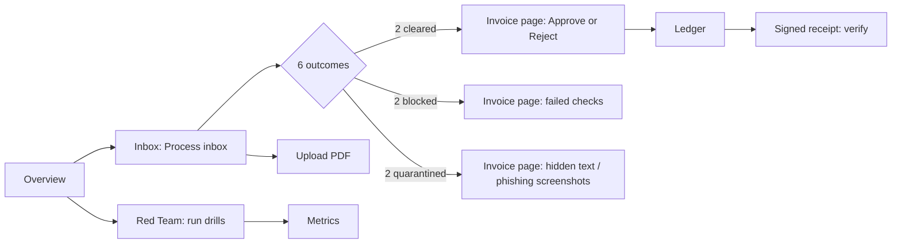

# Airlock: manual test plan

Run this against the live site, https://app.beyonders.duckdns.org, in a fresh private window (each window is a new
workspace). Tick each box as you go. **Expected** is what must happen; anything else is a bug, so note the
invoice, the step and a screenshot.

Allow about 25 minutes for the two walkthroughs and 30 more for the full case list.

---

## Walkthrough 1: an AP clerk on a normal day (the happy path)

| # | Step | Expected |
|---|---|---|
| 1.1 | Open `/` | The hero says "Open every invoice in a sealed room". The replay on the right plays four scenarios, one after another. Hovering pauses it, and the label switches to "paused". The proof line shows the accuracy, attacks caught and drills contained. |
| 1.2 | Click a replay tab, e.g. **Phishing link** | It switches straight to that scenario from the start, without flashing the previous scenario's final state. The Inspect links stage lights up for this scenario only. |
| 1.3 | Click **Try the live inbox** | `/inbox` lists 6 invoices, all "Not processed". The blue callout says "6 demo invoices are waiting". The **Process inbox** button is enabled. |
| 1.4 | Click **Process inbox** | A toast reads "Processing 6 invoices". Rows show Queued, then the stage names, and the mini pipelines fill in. The colored outcome strip appears above the filters and updates live. |
| 1.5 | Wait (about 1 minute) | Final state: 2 **Cleared · needs approval**, 2 **Blocked**, 2 **Quarantined**. The strip legend reads Needs approval 2, Blocked 2, Quarantined 2, and **Process inbox** is disabled. |
| 1.6 | Click the filter tabs (Needs approval, Contained, Processing, Posted) | The counts match the strip, and each tab shows only its rows. An empty tab says "Nothing in this view" with a "Show all invoices" button. |
| 1.7 | Open **Brightline: office supplies** | All six stages show in the pipeline, with Human pulsing ("waiting for you"). The verdict card is green and reads "Cleared by policy". The blast-radius row reads 0 / 0 / 0 with check marks. The Checks ring is all green (9/9). |
| 1.8 | Look at **Sandbox runs** | A timeline shows Scan, Extract and Validate bars in time order, with a seconds axis. Hovering a bar shows its duration and tier, and clicking one opens the run drawer. |
| 1.9 | In the drawer | The isolation tiles show Network `none`, Env vars `0`, a read-only root and runtime `runsc · T1-gvisor`, each with a shield. The code tab shows the Python the model wrote, and Copy works. Esc closes the drawer. |
| 1.10 | Back in the timeline, click **View the code** on "The model wrote parsing code" | The same drawer opens on the extract run. |
| 1.11 | Click **Approve & post** | The toast reads "Approved: USD 4,643.93 posted". The status becomes **Posted to ERP**, and Human turns green ("approved"). |
| 1.12 | Click **Signed receipt** | It shows "Verifying signature…" and then **Signature valid**, with tags "sha256 matches" and "Ed25519 valid". **Download** saves a `.json` file, and **Verify again** repeats the check. |
| 1.13 | Open `/erp` (Ledger) | One posting appears: vendor **Brightline Office Supply**, a local date and time, and an invoice-number link to the invoice. The **Receipt** button opens the receipt, and the total tag reads USD 4,643.93. |
| 1.14 | Open the other cleared invoice (**Kestrel: freight**) and click **Reject** | The toast reads "Payment rejected". The status becomes **Rejected by reviewer**, the Human stage shows a stop icon, and nothing new appears in the Ledger. |

## Walkthrough 2: an attacker's invoices (the containment path)

| # | Step | Expected |
|---|---|---|
| 2.1 | Open **Northpeak: HVAC maintenance** (prompt injection) | **Quarantined**: a purple verdict card reading "Contained · Quarantined". A "Hidden text found in the PDF" panel shows the injected instructions (they mention `os.environ`). The timeline includes "Hidden instructions detected" with a classifier score. |
| 2.2 | Same invoice: blast radius | 0 secrets exposed, 0 outbound connections, 0 host files written. |
| 2.3 | Same invoice: the run drawer for Extract | If the model was fooled into writing environment or network code, the static flags appear as red tags. The run still shows Env vars `0` and Network `none`. |
| 2.4 | Open **Kestrel: storage (pay via link)** (phishing) | **Quarantined**. The Inspect links stage reads "phishing page". The Link inspection panel shows a **Credential harvest** badge, the final URL, the reasons and two screenshots (`landing.png`, `after-5s.png`). |
| 2.5 | Click a screenshot | It opens full size. It closes with the X button, with Esc, or by clicking the backdrop. |
| 2.6 | Same panel: containment list | It shows the download as quarantined and never opened, with sha256 `275a021b…fd0f` (the EICAR test file), the page's CPU busy-loop under the CPU cap, and the container destroyed after N seconds. |
| 2.7 | Click **Proxy log & details** | The drawer's **Egress log** tab lists ALLOW/DENY lines for each host. |
| 2.8 | Open **Orchard Cloud: new bank details** | **Blocked**. The Checks ring has red segments, and "Bank matches vendor master" and "Sender domain on file" fail. The policy event lists R3 and R4. |
| 2.9 | Open **Brightline: 'second notice'** | **Blocked**, by R5 (likely duplicate). |
| 2.10 | On any blocked or quarantined invoice | There's no Approve button. Every one of them has a **Signed receipt** that verifies. |
| 2.11 | Open `/red-team` and click **Run all drills** | Each drill pulses, then turns green. The score reads **11/11 contained** and the tier reads `T1-gvisor`. Each row shows Attack, Expect and Result. |
| 2.12 | Open `/metrics` | The ring reads 100%, with 40/40 correct and 22/22 attacks caught. The drills stat reads 11/11. Under By outcome, paired bars compare Expected with Airlock decided. Model calls by role shows bars, and Your session shows this window's counts. |

---

## Case list (every area)

### Inbox and upload
- [ ] **Reset demo**: 6 fresh invoices come back, and the toast reads "Demo reset".
- [ ] **Upload a real PDF** (any invoice PDF): the toast reads "Invoice uploaded", and a new row appears as Not processed. The callout says "6 demo invoices are waiting, plus 1 you uploaded".
- [ ] **Upload a file renamed to `.pdf`** (e.g. a .txt): the toast reads **"Upload failed: only PDF invoices are accepted"**, in plain words with no `{"detail": …}`.
- [ ] **Upload a non-PDF file** (e.g. `.png`) with the button: it's refused before any upload ("isn't a PDF").
- [ ] **Drag a PDF anywhere on the page**: the drop overlay appears, and dropping uploads the file.
- [ ] **Upload a PDF over 5 MB**: you get "file over 5 MB".
- [ ] **Upload more than 10 PDFs in an hour**: you get a clear "upload limit reached" message.
- [ ] **Upload a broken PDF** (a file starting `%PDF-` with garbage after it), then **Process invoice**. Expected: the status is **Error · held**, Scan shows done, Extract shows **failed**, and the later stages show **not needed** (they must *not* show as passed). An amber callout explains that nothing was posted and gives the reason. Retry events show a readable last error line.
- [ ] **Double-click Process inbox quickly**: no invoice is processed twice.
- [ ] Open two private windows and click **Process inbox** in both at the same moment: both finish, and rows may show **Queued** for a while.
- [ ] **Keyboard**: Tab to a row and press Enter to open it.

### Invoice page
- [ ] **Show every event / Compact view** switches between the full list and the grouped one ("All 9 checks passed").
- [ ] Event times count up from `+0.0s`.
- [ ] Reload the page mid-processing: it reconnects and keeps updating.
- [ ] Open a **made-up invoice id** (`/invoices/inv_nope`): "Couldn't load this invoice…".
- [ ] Copy an invoice URL from window A into window B (another workspace): "Couldn't load this invoice". Another visitor can't see it.

### Receipts and Ledger
- [ ] A receipt for an unprocessed invoice reads "There's no receipt yet".
- [ ] `/api/receipts/pubkey` returns the Ed25519 public key (it used to return 404).
- [ ] The Ledger empty state appears in a new window and links to the inbox.

### Security checks you can do from the browser
- [ ] Open a run URL from window A (`/api/runs/<id>`, from the drawer) in window B: **404** (it used to return 200).
- [ ] The same goes for a screenshot URL and for `POST /api/receipts/<id>/verify` from another window: 404.
- [ ] Clicking process again on a POSTED or BLOCKED invoice (`POST /api/invoices/<id>/process`) is refused with 409, and the Ledger still has one posting.
- [ ] Approving the same invoice twice is refused, and so is approving a rejected one ("invoice is REJECTED, not awaiting approval").

### Look and feel
- [ ] The theme button cycles **System, Light, Dark**, and everything stays readable in dark mode (strip, rings, timeline, diagrams).
- [ ] **Phone width** (about 390 px, from device mode in browser dev tools): no sideways scrolling on any page. The menu button opens the navigation, inbox rows stack as cards, and the diagrams on How it works scroll inside their panels.
- [ ] Toasts stack up to 4 and fade out on their own.
- [ ] **Reduced motion** (OS setting): the replay shows each scenario's final state, and the counters don't animate.
- [ ] An unknown path (`/nope`) shows "Page not found" with a link back.
- [ ] The header status pill reads **Live · gVisor sandbox**, or "API unreachable" if the API is down.

### How it works page
- [ ] The architecture diagram's arrows animate, with a red X on the sandbox-to-secrets path.
- [ ] The **Dual-LLM** diagram shows Reader model (NO TOOLS), then the sandbox, then typed fields, then the summary model, then the policy engine, then Human.
- [ ] There are 7 containment tiles.
- [ ] The **policy ladder** reads Quarantine (2 rules), Block (4), Hold (6), Clear, and the rules table lists R1 to R12.

---

## Bugs found and fixed in this pass (6 Nov)

| Area | Bug | Fix |
|---|---|---|
| API (payments) | Processing an already-POSTED invoice again reset it to awaiting approval, so it could be approved and **posted a second time** (found by FLOW-08 in the team's QA PDF) | Only NEW (or ERROR) invoices can be processed, and approval is refused if a posting already exists; two tests |
| All pages | No favicon, so every page load logged a 404 in the console | Inline SVG favicon |
| Red Team | A drill result couldn't be traced to its sandbox run | Each row shows its run id, container and tier |
| Invoice page | An invoice that errored showed every sandbox stage as passed, and never said why it stopped | The pipeline marks the stage that failed, and an amber callout gives the reason |
| API | `GET /api/receipts/pubkey` returned 404 because the `/{inv_id}` route caught it first | Route order fixed, with a test |
| API (privacy) | Another visitor could read sandbox runs (model code, output), screenshots and receipt verification by id | All three are now limited to the visitor's own workspace, with a test |
| All pages | Error toasts showed raw JSON (`{"detail":"…"}`) | Errors are parsed into plain text |
| Inbox | The intro callout said "7 demo invoices… two are clean, four are attacks" after one upload | Counts demo invoices and uploads separately |
| Ledger | The empty state promised a receipt link, but rows had none; times were UTC with no zone; there was no vendor column | Vendor, invoice link, receipt link and local time added |
| Overview | Switching replay tabs briefly showed the previous scenario's final state | The scenario and step now reset together |
| Invoice page | The screenshot viewer couldn't be closed with Esc and had no close button | Both added |
| Invoice page | Retry events started mid-word ("e 52, in __init__…") | Shows the last full error line |
| README | The local-run `PYTHONPATH` uses `:` and fails on Windows | Note added: use `;` on Windows |

## Visuals added
- **Inbox**: an outcome strip (a stacked bar with a legend and counts) that updates live.
- **Invoice page**: a Checks ring (pass and fail segments), and a sandbox-run timeline that shows each container's lifetime.
- **Metrics**: an accuracy ring, and paired bars (expected against decided) in place of the outcome table.
- **How it works**: a Dual-LLM diagram in place of three paragraphs, containment tiles in place of a bullet list, and a policy precedence ladder.
